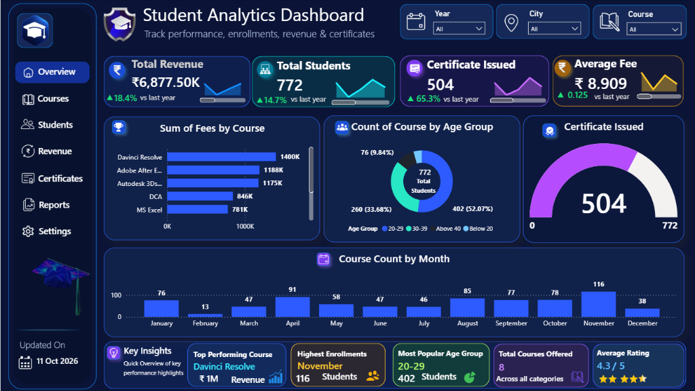
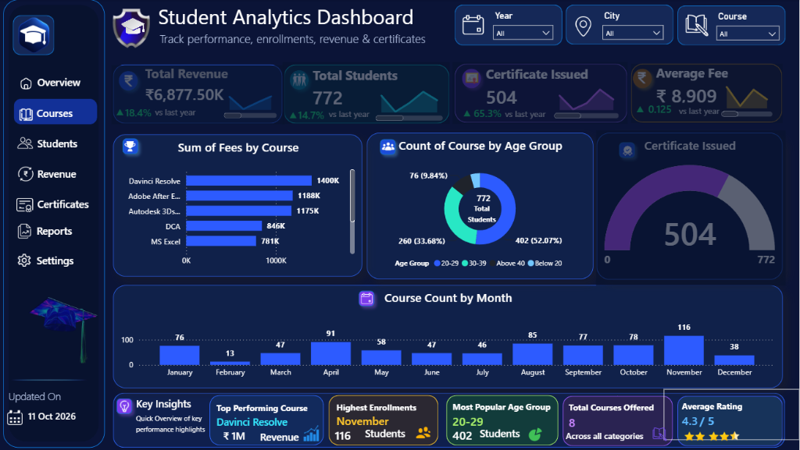

# 🎓 Student Analytics & Revenue Performance Dashboard — ABC Institute

[](https://powerbi.microsoft.com/)
[](https://learn.microsoft.com/en-us/dax/)
[](LICENSE)
[](https://Fasee9831.github.io/ABC-Institute-Student-Analytics-Dashboard/)

> An executive business intelligence solution engineered in **Microsoft Power BI** to analyze student enrollments, academic certification throughput, seasonal demand fluctuations, and revenue drivers for **ABC Institute**.

---

## 📸 Dashboard Previews

### 1. Executive Overview View
The primary operational cockpit presenting top-level KPIs, 12-month mini sparklines, course revenue distribution, age demographics, certificate completion progress, and monthly enrollment trends.



### 2. Courses View
The focused curriculum view highlighting specific course performance and feedback ratings across educational tracks.



---

## 💼 Business Problem & Executive Summary

Educational institutes offering professional skill training frequently face three critical operational blind spots:
1. **Unpredictable Intake Seasonality**: Severe enrollment swings throughout the calendar year leave instructors underutilized in slow months and administrative staff overwhelmed during peak periods.
2. **Revenue Concentration Risk**: Reliance on a small subset of courses without quantitative insight into tuition pricing elasticity or cohort demographics.
3. **Academic Drop-off & Certification Bottlenecks**: High initial signups with inadequate tracking of verified course completions and certifications.

### Core Objectives
- **Monitor Commercial Health**: Track gross tuition revenue, average fee realization per student, and Year-over-Year (YoY) financial growth.
- **Demographic Cohort Analysis**: Profile student age distributions to inform targeted performance marketing campaigns.
- **Seasonality Diagnostics**: Identify annual demand patterns to optimize cohort batch scheduling and digital marketing spend.
- **Measure Graduation Throughput**: Evaluate certification completion rates to ensure student success and maintain high institutional ratings.

---

## 📊 Key Business Findings & Data Insights

Based on the verified dataset and analytical report:

| Metric Category | Key Metric | Verified Value | YoY Growth | Strategic Interpretation |
| :--- | :--- | :--- | :--- | :--- |
| **Financial** | **Total Revenue** | **₹6,877.50K** (~₹6.88M) | **▲ 18.4%** | Strong double-digit top-line revenue expansion driven by premium technical courses. |
| **Volume** | **Total Students** | **772** | **▲ 14.7%** | Healthy annual expansion in student enrollment volume across all tracks. |
| **Academic** | **Certificates Issued** | **504** | **▲ 65.3%** | **65.28% completion rate** (504 of 772). Significant surge in student completions YoY. |
| **Pricing** | **Average Course Fee** | **₹8,909** | **▲ 12.5%** | Higher fee realization reflecting successful premium course positioning. |
| **Satisfaction** | **Average Student Rating** | **4.3 / 5.0 ⭐** | — | High learner satisfaction across all 8 active curricula. |

### In-Depth Analytical Highlights

1. **Revenue Leaders — Multimedia & 3D Dominate**:
   - **DaVinci Resolve** is the #1 revenue driver, single-handedly generating **₹1,400,000 (~₹1.40M)**.
   - **Adobe After Effects** ranks #2 at **₹1,188,000 (~₹1.19M)**, closely followed by **Autodesk 3ds Max** at **₹1,175,000 (~₹1.18M)**.
   - Foundational courses such as **DCA (₹846K)** and **MS Excel (₹781K)** provide steady baseline revenue, but multimedia and video editing commands premium pricing power.

2. **Demographic Breakdown — Young Professionals Drive Growth**:
   - **20–29 Age Cohort**: Accounts for **52.07% (402 students)** — the primary customer base consisting of college students and early-career professionals upskilling for the creative industry.
   - **30–39 Age Cohort**: Captures **33.68% (260 students)** — working professionals seeking mid-career transitions or advanced digital proficiencies.
   - **Above 40**: Represents **9.84% (76 students)**.
   - **Below 20**: Represents **4.41% (34 students)**.

3. **Intake Seasonality & Demand Volatility**:
   - **Peak Intake (November)**: **116 students** enrolled (highest month of the year), supported by strong Q4 demand (**August: 85**, **September: 77**, **October: 78**, **April: 91**).
   - **Enrollment Trough (February)**: A sharp drop to just **13 students**, indicating seasonal lulls following post-holiday periods.

4. **Certification Completion Rate**:
   - The radial gauge reveals **504 out of 772 students** successfully achieved certified status (**65.28%**). While up **65.3% YoY**, roughly one-third of enrolled learners remain uncertified, indicating an opportunity for targeted academic follow-up.

---

## 🎯 Practical Business Recommendations

1. **Mitigate the February Slump via "Early-Bird" Campaigns**:
   - Launch targeted promotional discounts, bundle pricing (e.g., *Excel + DCA Career Starter Pack*), and corporate cohort onboarding in December–January to smooth out the severe enrollment dip in February.
2. **Double Down on Creative & Video Production Curricula**:
   - Given that *DaVinci Resolve*, *After Effects*, and *3ds Max* contribute the majority of revenue, introduce advanced masterclasses (e.g., Color Grading, Unreal Engine for VFX, Motion Graphics) to capture upsell opportunities.
3. **Launch an Automated Student Completion & Certification Push**:
   - Introduce automated milestone reminders and mentor check-ins for the ~34.7% of students who have enrolled but not yet attained certification, driving alumni referrals and repeat enrollment.
4. **Tailor Social Ads to the 20–29 Age Demographic**:
   - Focus digital marketing budgets on Instagram, YouTube, and LinkedIn where 20–29 year-olds actively seek portfolio-building credentials.

---

## 🛠️ Tools & Technologies Used

- **Microsoft Power BI Desktop**: Core data modeling, calculated DAX measures, time-series sparklines, custom gauge visualizations, and interactive slicers.
- **Power Query (M Engine)**: Ingestion, schema validation, type casting, age cohort bucketing, and data sanitization.
- **DAX (Data Analysis Expressions)**: Dynamic YoY growth percentages, time intelligence, conditional formatting, and card metrics.
- **Modern UI/UX Dark Theme**: Deep midnight-blue aesthetic (`#090D1A` / `#0E162B`) with high-contrast neon accents, pill navigation, and rounded card containers.
- **Web Technologies**: HTML5, Modern CSS (Flexbox & CSS Grid), JavaScript for the portfolio webpage.

---

## 📐 Data Model Architecture

The data architecture utilizes a relational model connecting two core tables:

```
[Personal Details]                        [Student Course Details (2)]
------------------                        ----------------------------
Student Name (Primary Key) <-----------> Student Name (Foreign Key)
City                                      Course
Issued Certificate ("Yes"/"No")           Fees
                                          Age
                                          Age Group (Bucketed: <20, 20-29, 30-39, >40)
                                          Date of Join (Date Hierarchy)
                                          Month
```

### Verified DAX Measures Summary
- `Total Revenue` = `SUM('Student Course Details (2)'[Fees])` → **₹6,877.50K**
- `Total Students` = `DISTINCTCOUNT('Student Course Details (2)'[Student Name])` → **772**
- `CountYes (Certificates Issued)` = `CALCULATE(COUNTROWS('Personal Details'), 'Personal Details'[Issued Certificate] = "Yes")` → **504**
- `Average Fee` = `AVERAGE('Student Course Details (2)'[Fees])` → **₹8,909**
- `Top Performing Course` = `TOPN(1, VALUES('Student Course Details (2)'[Course]), [Total Revenue], DESC)` → **DaVinci Resolve**
- `Highest Enrollment Month` = `November` → **116 Students**

*For complete modeling and calculation details, refer to [docs/methodology.md](docs/methodology.md).*

---

## 📁 Repository Structure

```
ABC-Institute-Student-Analytics-Dashboard/
├── .gitignore                      # Git exclusion rules
├── LICENSE                         # MIT License
├── README.md                       # Comprehensive project documentation
├── index.html                      # Responsive GitHub Pages portfolio showcase
├── assets/
│   ├── css/
│   │   └── style.css               # Portfolio styling & responsive layout
│   ├── js/
│   │   └── main.js                 # Interactive image viewer & metrics scripts
│   └── images/
│       ├── dashboard-overview.png  # High-resolution capture of Overview Page
│       └── dashboard-courses.png   # High-resolution capture of Courses Page
├── dashboard/
│   └── ABC-Institute-Report.pbix   # Full Power BI report file (662 KB)
└── docs/
    └── methodology.md              # Technical methodology & DAX implementation guide
```

---

## 🚀 How to View or Run This Project

### 1. View Online
Visit the live portfolio showcase hosted on GitHub Pages:
🔗 **[https://Fasee9831.github.io/ABC-Institute-Student-Analytics-Dashboard/](https://Fasee9831.github.io/ABC-Institute-Student-Analytics-Dashboard/)**

> **Note on Interactivity**: The web portfolio displays high-resolution visual previews with interactive exploratory metric summaries. Full interactive cross-filtering, slicing, and drill-through require opening the report in Power BI Desktop.

### 2. Run Locally in Power BI Desktop
1. Clone this repository:
   ```bash
   git clone https://github.com/Fasee9831/ABC-Institute-Student-Analytics-Dashboard.git
   ```
2. Navigate to the `dashboard/` folder:
   ```bash
   cd ABC-Institute-Student-Analytics-Dashboard/dashboard
   ```
3. Open `ABC-Institute-Report.pbix` with [Microsoft Power BI Desktop](https://powerbi.microsoft.com/desktop/) (free download).

---

## 🔒 Data Privacy & Compliance

This report contains synthetic educational training records and aggregate statistics designed for performance benchmarking. All figures, metrics, and visual cards comply with standard privacy best practices and contain no individual personal identifiable information (PII) such as phone numbers, emails, or personal identification records.

---

## 👩‍💻 Author & Contact

**Faseeha Zulaika N.**  
*Artificial Intelligence & Data Science | Power BI | Python | SQL*

- **GitHub**: [@Fasee9831](https://github.com/Fasee9831)
- **Portfolio Repository**: [ABC-Institute-Student-Analytics-Dashboard](https://github.com/Fasee9831/ABC-Institute-Student-Analytics-Dashboard)

---
*Developed as part of the Data Analytics Portfolio Showcase. If you find this project valuable, please consider giving it a ⭐!*
